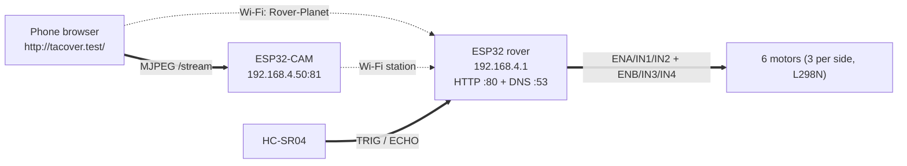

# Tacover — 6-wheel ESP32 rover

Firmware and web UI for **Tacover**, a 6-wheel skid-steer rover driven from a phone browser.

The rover is its own Wi-Fi access point. It serves the control page over HTTP and speaks to an
ESP32-CAM that streams MJPEG from the same network, so no router, app install, or internet
connection is needed.

| | Rover | Camera |
|---|---|---|
| Board | ESP32 dev module (`esp32:esp32:esp32`) | AI Thinker ESP32-CAM (`esp32:esp32:esp32cam`) |
| Sketch | [`esp32/tacover6/tacover6.ino`](esp32/tacover6/tacover6.ino) | [`esp32-cam/CameraWebServer/CameraWebServer.ino`](esp32-cam/CameraWebServer/CameraWebServer.ino) |
| Role | SoftAP `Rover-Planet`, HTTP `:80`, DNS `:53` | Wi-Fi station at a fixed `192.168.4.50`, HTTP `:81` |
| Build size¹ | 958,579 B flash (73%) · 47,668 B RAM (14%) | 1,000,885 B flash (31%) · 59,048 B RAM (18%) |

¹ verified with `arduino-cli` 1.5.1 against esp32 core 3.3.12; see [Build & upload](#build--upload).

## Repository layout

```
esp32/
  tacover6/tacover6.ino          current rover firmware (active)
  archive/tacover3.ino           earlier revisions, kept for reference
  archive/tacover4/tacover4.ino
  archive/tacover5/tacover5.ino
esp32-cam/
  CameraWebServer/               ESP32-CAM MJPEG streamer
```

Only `esp32/tacover6/` and `esp32-cam/CameraWebServer/` are meant to be flashed; `esp32/archive/`
holds superseded revisions (see [Version history](#version-history)).

## System overview



| Address | Device | Notes |
|---|---|---|
| `192.168.4.1` | Rover (SoftAP + web server) | also reachable as `http://tacover.test/` |
| `192.168.4.50` | Camera, HTTP port 81 | fixed IP, set before `WiFi.begin()` |
| `192.168.4.2`+ | Phone | DHCP lease from the rover's SoftAP |

The rover runs a wildcard DNS server (`DNSServer`, port 53) that answers **every** hostname with
`192.168.4.1`, which is why `http://tacover.test/` works without mDNS or a captive portal page.

Wi-Fi credentials: SSID `Rover-Planet`, password `rover1234` (channel 1, visible, max 4 clients).
Both sketches hardcode these, so change them in both files or in neither.

## Hardware

| Part | Notes |
|---|---|
| ESP32 dev module | 2.4 GHz Wi-Fi; Arduino core 2.0.18 or 3.x |
| L298N motor driver | one channel per side, 3 motors paralleled per side |
| 6 × DC gear motor | skid steering — no steering servo |
| HC-SR04 ultrasonic | forward-facing; **ECHO must go through a voltage divider** (5 V → 3.3 V) |
| AI Thinker ESP32-CAM | OV2640, PSRAM; on-board flash LED on GPIO 4 |
| Phone | any browser with `fetch`, `pointer` events, canvas |

### Rover pin map

| Signal | GPIO | Function |
|---|---|---|
| `ENA` | 25 | left side PWM (L298N ENA) |
| `IN1` | 26 | left side direction |
| `IN2` | 27 | left side direction |
| `ENB` | 33 | right side PWM (L298N ENB) |
| `IN3` | 32 | right side direction |
| `IN4` | 19 | right side direction |
| `TRIG` | 5 | ultrasonic trigger (output) |
| `ECHO` | 18 | ultrasonic echo (input, via divider) |

`IN1/IN2` set the left direction, `IN3/IN4` the right. `ENA`/`ENB` carry a 2 kHz, 8-bit PWM signal
(via `ledcAttach` on core 3.x, `ledcSetup`/`ledcAttachPin` on 2.x — both paths are in the sketch).

## Rover firmware (`tacover6`)

The sketch is self-contained: motors, ultrasonic, Wi-Fi AP, DNS and the whole web UI.

**Driving.** The page does not send left/right values; it sends a vector and the firmware mixes it:

* `x` = turn, `y` = forward, both clamped to `-100..100`
* `left = y + x`, `right = y - x`, scaled down proportionally if either exceeds 100 (skid steering)
* any non-zero speed maps to a duty between `MIN_DUTY = 90` and 255, because the motors do not
  turn below ~35% duty
* **failsafe:** if no `/drive` (or `/stop`) arrives for `FAILSAFE_MS = 500` ms, the firmware drives
  both sides at zero. Closing the browser tab stops the rover.
* **obstacle stop:** while the ultrasonic reads less than `STOP_CM = 20` cm, forward (`y > 0`) is
  forced to 0. Turning and reversing deliberately still work, so you can back out of a corner.
* the ultrasonic is sampled every 80 ms (~12 Hz); a reading of `-1` means "nothing in range".

### HTTP API (rover, port 80)

| Route | Method | Behaviour |
|---|---|---|
| `/` | GET | The full control page, served gzip-compressed from `INDEX_HTML_GZ` |
| `/simple` | GET | Fallback page: plain HTML, D-pad, speed slider, distance readout |
| `/drive?x=<int>&y=<int>` | GET | Sets the drive vector (clamped to ±100), resets the failsafe timer |
| `/stop` | GET | Zeroes the vector, resets the failsafe timer |
| `/status` | GET | `{"distance":cm,"blocked":bool,"left":int,"right":int,"phones":int}` |
| `/favicon.ico` | GET | `204 No Content` |

`distance` is `-1` when nothing is detected, `phones` counts associated stations.

### Embedded control page

`INDEX_HTML_GZ` is a gzip stream (12,969 bytes) that inflates to a 48,808-byte single-file page,
returned with `Content-Encoding: gzip`. It is one HTML file with no external requests:

* portrait → camera above the D-pad, landscape → camera in a right-hand column
* camera box can be **docked** (big, fixed) or **mini** (drag the corner handle to resize, lockable)
* gears: Crawl 30 / Cruise 55 / Fast 80 / Boost 100 (default 55), remembered in `localStorage`
* hold-to-drive: `/drive` repeats every 150 ms while a direction is held, `/stop` on release
* telemetry panel: obstacle distance, blocked flag, left/right output, polled every 500 ms
* "photo" copies the frame on screen to a canvas and downloads it as a JPEG (no camera round-trip)
* a built-in **mock mode** simulates telemetry and driving without any hardware
* settings for robot and camera address, persisted per field in `localStorage`

Note: the readable source of this page is **not** in this repository — only the gzip byte array is
committed. Its comments reference the upstream TypeScript app (`src/robot/types.ts`,
`src/hooks/useRobotStatus.ts`, `TempChart.tsx`). To change the UI you must inflate the array, edit
the HTML, and re-embed it (see [Build & upload](#build--upload)).

## Camera firmware (`esp32-cam/CameraWebServer`)

A deliberately small MJPEG streamer for the AI Thinker module. It joins `Rover-Planet` as a
**station** at a fixed `192.168.4.50` (applied with `WiFi.config()` *before* `WiFi.begin()`;
`WiFi.setSleep(false)` keeps the stream smooth) and serves on port 81. Frames are QVGA JPEG,
quality 12, `CAMERA_GRAB_LATEST`, 2 frame buffers when PSRAM is found, 1 otherwise.

| Route | Method | Behaviour |
|---|---|---|
| `/` | GET | Small test page: live stream, Light ON/OFF buttons, photo link |
| `/stream` | GET | `multipart/x-mixed-replace; boundary=frame` MJPEG, `Access-Control-Allow-Origin: *` |
| `/photo` | GET | one JPEG (`Content-Length` set, CORS allowed) |
| `/flash/on`, `/flash/off` | GET | drives the on-board flash LED on GPIO 4 |

The CORS header on `/stream` is what lets the rover page copy a live frame into a photo; without it
the canvas is tainted and the page reports "Camera blocks photos".

The rover page derives the feed URL as `http://<camera-address>:81/stream`, so the port 81
convention is part of the contract between the two sketches.

## Build & upload

Requirements: Arduino IDE 2.x (or `arduino-cli`), the **esp32** boards package with an ESP32 core
(2.0.18 or 3.3.12 both work), and the built-in `WiFi`, `WebServer`, `DNSServer` and `esp_camera`
libraries. Nothing else to install.

```sh
# rover (change the sketch only if you are not using an ESP32 dev module)
arduino-cli compile --fqbn esp32:esp32:esp32               esp32/tacover6

# camera (AI Thinker board preset: PSRAM + Huge APP partition)
arduino-cli compile --fqbn esp32:esp32:esp32cam            esp32-cam/CameraWebServer
```

Both commands were verified to build (rover sketch: no warnings, even with `--warnings all`; camera
sketch: one deprecation warning, see below). Upload with
`arduino-cli upload -p <port> --fqbn <fqbn> <sketch>` or with the IDE's Upload button. In the IDE,
open the `.ino` file, pick the board — *ESP32 Dev Module* for the rover, *AI Thinker ESP32-CAM* for
the camera — and leave the default partition/flash settings the board presets already imply
(`huge_app`, PSRAM enabled, `dio`).

Re-embedding an edited control page:

```sh
# 1. edit index.html, 2. gzip it, 3. paste the bytes and length into INDEX_HTML_GZ
gzip -9 -c index.html | xxd -i        # then update INDEX_HTML_GZ_LEN to the gzip size
```

The firmware is served compressed only because of that array; if you change the page you must also
update the declared `INDEX_HTML_GZ_LEN` (currently 12,969), or the browser will get a truncated
response.

## First run

1. Power the rover and the camera; both come up on `Rover-Planet`.
2. On the phone, connect to Wi-Fi `Rover-Planet`, password `rover1234`.
3. Open `http://tacover.test/` — or `http://192.168.4.1/` if the phone is being difficult.
4. Open the menu (☰) → *Camera* → enable **Show camera** (default address `192.168.4.50`).
5. Hold a direction, pick a gear, release to stop. Watch the telemetry panel for the blocked flag.

Serial monitors run at 115200 baud and print the ready banner, the AP IP and the chosen URL.

## Version history

All revisions drive the same four GPIO groups and the same HTTP API; they differ in the embedded
page and in how the rover is reached.

| Version | Embedded page (gzip / inflated) | Reaching the rover |
|---|---|---|
| `tacover3` | 9,599 B / 33,816 B | `http://192.168.4.1` |
| `tacover4` | 11,956 B / 45,558 B — docked/mini camera view | `http://192.168.4.1` |
| `tacover5` | 12,969 B / 48,808 B — camera above the controls, photo button | `http://192.168.4.1` |
| `tacover6` | identical to v5 | `http://tacover.test` via wildcard DNS |

`tacover6` is the current one; the earlier files stay in `esp32/archive/` only as history. The only
behavioural difference is the DNS/captive-portal work and the failure checks around `WiFi.softAP()`
and `dnsServer.start()`.

## Notes & known limits

* **One forward sensor** — a single HC-SR04 facing forward; the rover can still clip an obstacle
  while turning or reversing, and low obstacles may go undetected.
* **`rover.test` versus `tacover.test`** — the header comment of `tacover6.ino` still says
  `rover.test` while the firmware logs `tacover.test`. The wildcard DNS answers both, but the
  documented name is `tacover.test`.
* **Temperature panel has no sensor** — the control page parses a `temperature` field from
  `/status` (inherited from the upstream TS app) but the firmware never sends one, so the panel
  permanently reads "No sensor". Adding a real sensor (DHT/DS18B20) and the JSON field is the fix.
* **`phones` is unused by the UI** — the firmware reports the station count; the page ignores it.
* **`/simple` is a second, diverging UI** — small fallback page without camera or gears; useful if
  the gzip page is ever broken, but it is not linked from anywhere.
* **Static camera IP** — `192.168.4.50` is assumed to be outside the rover's DHCP lease range (the
  sketch's own comment says leases start at `192.168.4.2`). With at most 4 clients this is fine in
  practice; if you ever raise the client limit, pinch the pool with `WiFi.softAPConfig()`.
* **Vestigial example files** — `esp32-cam/CameraWebServer/` still carries `app_httpd.cpp`,
  `camera_index.h`, `camera_pins.h`, `board_config.h`, `ci.yml` and `partitions.csv` from the
  Arduino-ESP32 `CameraWebServer` example. The custom sketch does not include or call them, and the
  linker dead-strips them (~12 bytes flash), but `board_config.h` still selects
  `CAMERA_MODEL_ESP_EYE` — an ESP-EYE pin map that contradicts the AI Thinker pins hardcoded in the
  sketch. Anything re-enabling `startCameraServer()` would come up with the wrong camera wiring.
* **One driver at a time** — the API is last-write-wins with no auth; several phones can connect
  (max 4) but only one should drive.
* **Deprecation warning on core 3.x** — the camera sketch calls `server.available()`, renamed
  `accept()` in ESP32 core 3.x. It still compiles; the warning is harmless.

## License

MIT — see [LICENSE](LICENSE).

Third-party code: `esp32-cam/CameraWebServer/` is derived from the Espressif/Arduino-ESP32
`CameraWebServer` example. `app_httpd.cpp` carries its original Espressif Apache-2.0 header and
`camera_index.h` is a generated Espressif asset; keep those notices if you redistribute them. The
rover sketches, the embedded control page and this documentation are original to this project.
